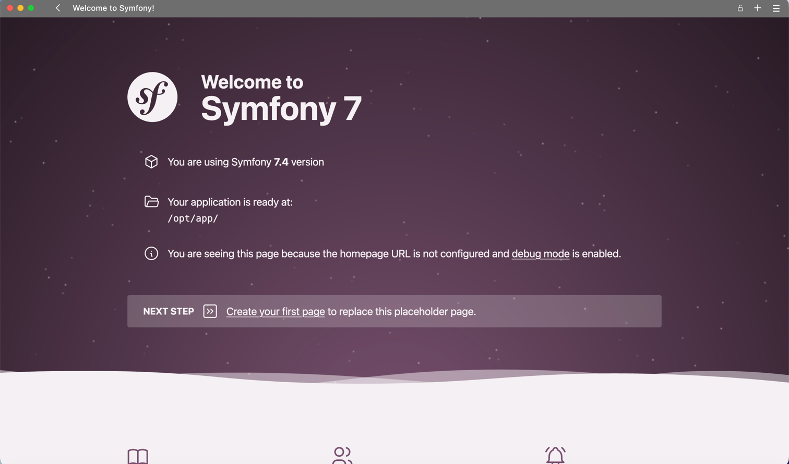
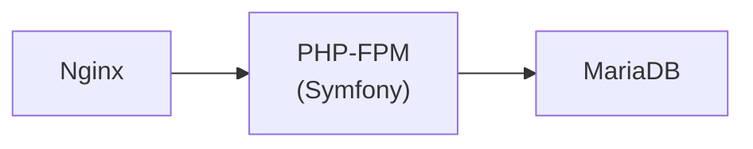

# Symfony local environment
En este proyecto se encuentra un ambiente local para desarrollar proyectos con Symfony

---
# Pa' empezar
## Requerimientos
<div class="table">

| Requerimiento                                             | Descripción                                                                                                                                                                                                                      |
|-----------------------------------------------------------|----------------------------------------------------------------------------------------------------------------------------------------------------------------------------------------------------------------------------------|
| [Docker](https://www.docker.com/products/docker-desktop/) | La idea es que puedas ocupar este ambiente en cualquier computadora. Es suficiente con tener Docker para trabajar.                                                                                                               |
| [Compose](https://docs.docker.com/compose/)               | Docker se ocupa para poder correr los contenedores, pero compose se utiliza para aplicar un comando para arrancar varios contenedores al mismo tiempo y que éstos estén conectados de manera sencilla a través de configuración. |

</div>

## ¿Qué contiene este proyecto?
La idea de clonar este proyecto es que puedas ejecutar `docker compose up` y que se arranquen un par de contenedores:
* Uno de PHP con FPM que nos ayudará a correr todos los comandos de PHP y Symfony
* Uno de MariaDB que se usará para guardar datitos en nuestro proyecto
* Uno de Nginx que expone por HTTP nuestro Syfmony sin tener que correr el comando `php -S`  


## Para configurar antes de arrancar
Es necesario que le eches una ojito al archivo `.env.compose` donde se utilizan algunas variables de ambiente para
determinar valores generales de ambiente.

Aquí te pongo una tablita con la variables de ambiente más importantes y para qué sirven:
<div class="table-3">

| Variable                 | Descripción                                                                                                                                                                                                                                                                                                 | Default                   |
|--------------------------|-------------------------------------------------------------------------------------------------------------------------------------------------------------------------------------------------------------------------------------------------------------------------------------------------------------|---------------------------|
| `DATABASE_ROOT_PASSWORD` | Se utiliza para configurar la contraseña del usuario `root` de MariaDB                                                                                                                                                                                                                                      | `lotus_password_root_123` |
| `DATABASE_NAME`          | Se utiliza para establecer el nombre de la base de datos al arrancar el contenedor de MariaDB<br/><br/>Se usa también para establecer la conexión de Symfony con la base de datos                                                                                                                           | `lotus`                   |
| `DATABASE_USERNAME`      | Se utiliza para colocar un nombre de usuario alternativo al usuario `root` que se creará junto con su contraseña donde el contenedor de MariaDB automáticamente le asigna los permisos `GRANT ALL` a la base de datos. <br/><br/>Se usa también para configurar la conexión de Symfony con la base de datos | `lotus`                   |
| `DATABASE_PASSWORD`      | La contraseña con la que se autenticará el nombre de usuario de la línea anterior<br/><br/>Se usa también para establecer la conexión de Symfony con la base de datos                                                                                                                                       | `lotus_password_123`      |
| `SYMFONY_VERSION`        | Para definir qué versión de Symfony quieres que instale el proyecto si no hay una versión instalada                                                                                                                                                                                                         | `7.4`                     |
| `UNIQUE_INSTALLATION`    | El nombre del archivo para determinar que es una instalación fresca o que no es necesario instalar symfony de cero. Si existe, ignorará la instalación de Symfony al arrancar los contenedores                                                                                                              | `composer.lock`           |
</div>

# Viene lo bueno

Una vez que hayas configurado las variables de ambiente a tu gusto, con las credenciales que mejor te parezcan, 
sólo es necesario que hagas un sólo movimiento: 

```bash
docker compose up # [-d]
```
> La notación de comandos entre corchetes `[-option]` suele indicar que el valor es opcional. 
> 
> `[-d]` es una opción disponible de docker para enviar el comando al background. Quizás lo quieras hacer siempre,
> pero te sugiero que la primera vez no la uses para ver qué es lo que pasa mientras se instala lo necesario para
> arrancar tu proyecto

Al cabo de unos minutos, verás en la terminal donde arranques ejecutes el proyecto la primera vez algo como esto: 
```plain
Container test-1-mariadb-1 Healthy

php-1      | Creating a "symfony/skeleton:7.4.*" project at "./tmp"
php-1      | Installing symfony/skeleton (v7.4.99)
php-1      | Created project in /opt/app/tmp
php-1      | /opt/app
php-1      | No composer.lock file present. Updating dependencies to latest instead of installing from lock file. See https://getcomposer.org/install for more information.
###...
php-1      | Some files have been created and/or updated to configure your new packages.
php-1      | Please review, edit and commit them: these files are yours.
php-1      |
php-1      | No security vulnerability advisories found.
php-1      | Using version ^1.68 for symfony/maker-bundle
php-1      | [31-Oct-2026 16:48:26] NOTICE: fpm is running, pid 1
php-1      | [31-Oct-2026 16:48:26] NOTICE: ready to handle connections
```
En caso que **no** sea la primera vez, la información de instalación no estará disponible en la terminal pero si verás igualmente
algo como esto: 
```plain
Container test-1-mariadb-1 Healthy
php-1      | [31-Oct-2026 16:50:51] NOTICE: fpm is running, pid 1
php-1      | [31-Oct-2026 16:50:51] NOTICE: ready to handle connections
```

## Flujo de servicios

En tanto esté listo el ambiente y tus servicios estén disponibles, puedes entrar en el navegador a la dirección `http://127.0.0.1:8090` y
verás una pantallita como esta: 


Nginx recibe las solicitudes HTTP y las envía a PHP. La aplicación Symfony se conecta después a MariaDB para consultar o guardar datos.


